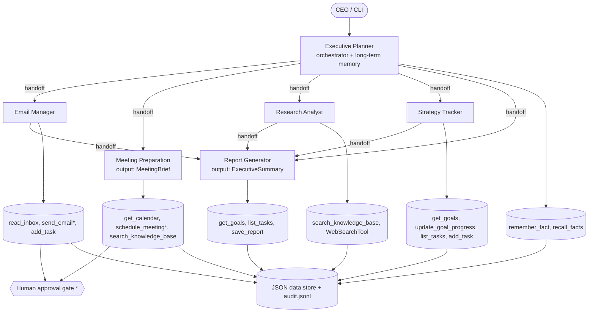

# Multi-Agent Architecture

`*` = requires human approval before executing.

## Agents and roles
| Agent | Role | Tools | Output |
|---|---|---|---|
| Executive Planner | Routes requests, holds long-term memory | remember_fact, recall_facts | text / handoff |
| Email Manager | Triage, draft, send replies | read_inbox, send_email*, add_task | text |
| Meeting Preparation | Calendar, scheduling, briefs | get_calendar, schedule_meeting*, search_knowledge_base | `MeetingBrief` |
| Research Analyst | Internal + web research | search_knowledge_base, WebSearchTool | text |
| Strategy Tracker | Goals, tasks, priorities | get_goals, update_goal_progress, list_tasks, add_task | text |
| Report Generator | Executive summaries | get_goals, list_tasks, save_report | `ExecutiveSummary` |

## Handoff flow
Planner → any specialist. Email / Research / Strategy → Report Generator when a formal summary
is requested. Example: "Summarise my inbox and what needs a decision" → Planner → Email Manager
→ Report Generator.

## Memory and context
- **Shared run context** (`AppContext`): passed to every agent/tool (user, approval mode).
- **Session persistence**: `SQLiteSession` keeps conversation history across runs (`--session NAME`).
- **Long-term memory**: `memory.json` via `remember_fact`; injected into the Planner's dynamic instructions each run.
- **Knowledge retrieval (RAG-lite)**: keyword-scored search over `knowledge.json`.

## Advanced features implemented
Planning/routing, RAG-lite retrieval, long-term memory, parallel execution (`/briefing` runs 3
agents with `asyncio.gather`), error handling (per-branch failures, `MaxTurnsExceeded`, rejected
approvals), audit logging (`logs/audit.jsonl`), session persistence, human approval.
